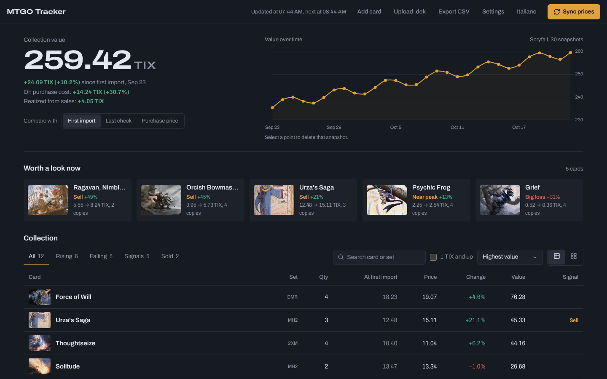
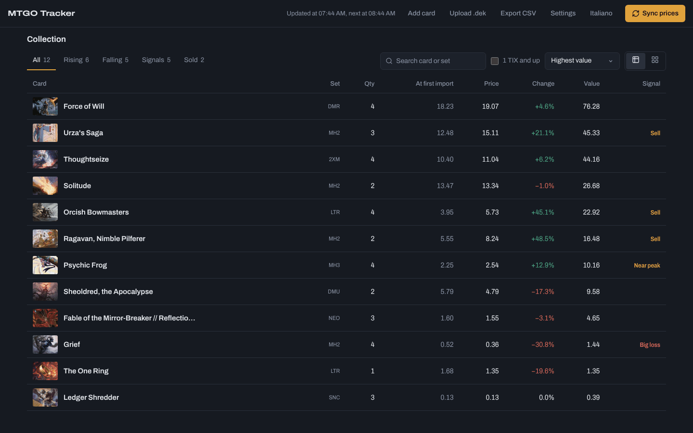
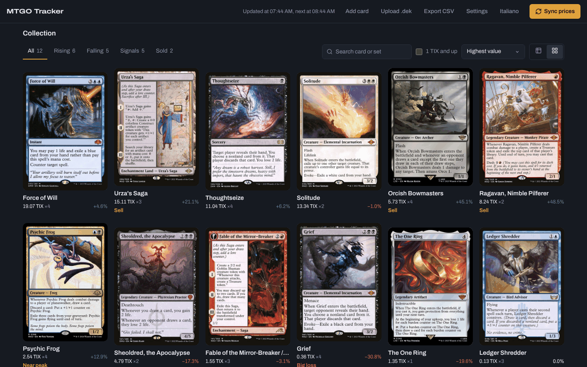
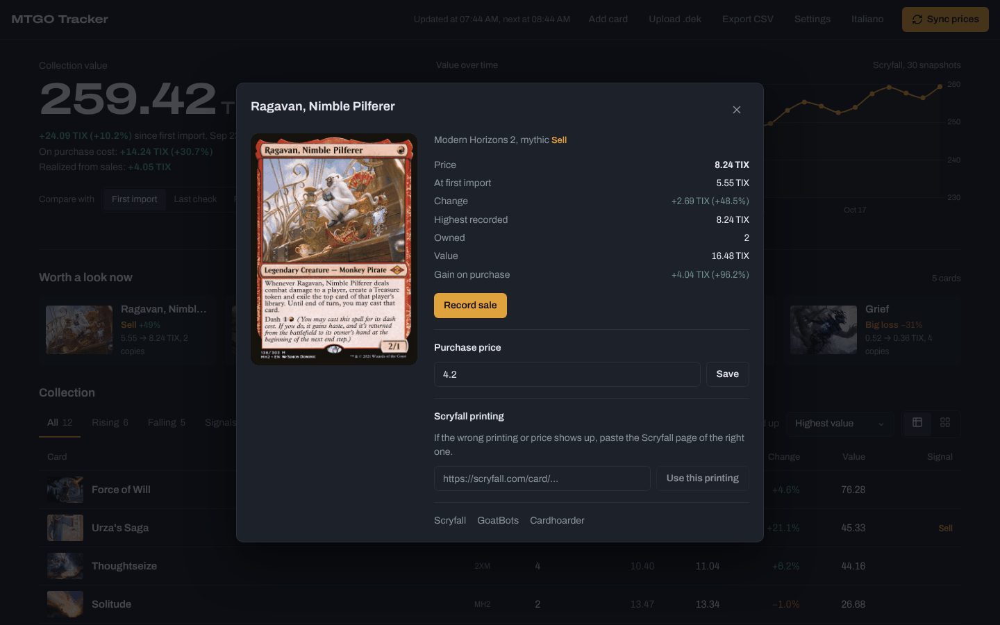
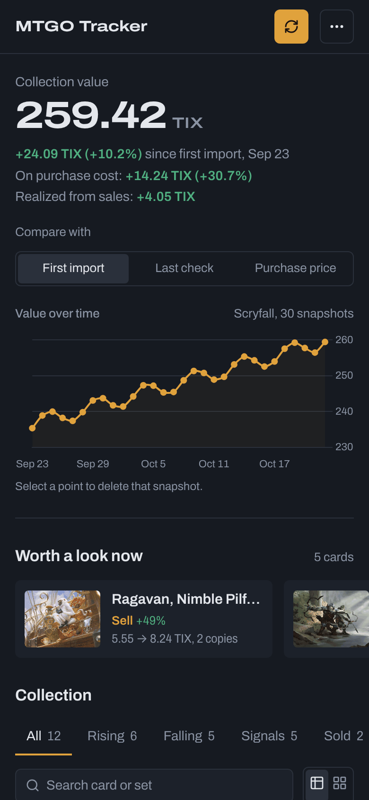
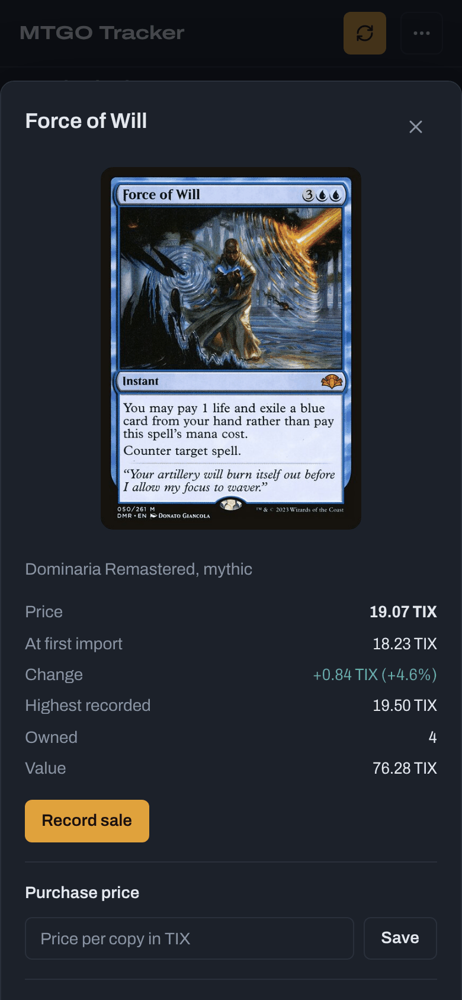

# MTGO Collection Tracker

A self-hosted web app that tracks what your **Magic: The Gathering Online** collection is worth in **Event Tickets (TIX)**: how prices move since you imported it, what you paid, what you sold, and which cards are worth a look right now.

Upload the `.dek` file exported from MTGO; the server fetches prices on a schedule, keeps a value history and flags cards to sell.



## Features

- **Collection value and P&L**: total value in TIX and its change since the first import, plus the gain on purchase cost and the profit realized from sales.
- **Compare with**: switch every price change between the first import (Time 0), the last price check and your purchase price.
- **Value over time**: a snapshot is saved at every price sync (the latest 500 are kept). Select a point on the chart to delete that snapshot.
- **Worth a look now**: cards with a trading signal, measured against the first import:
  - **Sell**: up at least 35%, or up at least 0.75 TIX and 20%;
  - **Near peak**: within 5% of the highest recorded price and more than 10% up;
  - **Big loss**: down 30% or more.
- **Collection table or card grid**: tabs for all, rising, falling, signalled and sold cards; search by card or set; a "1 TIX and up" filter; sorting by value, price, change, gain on purchase, quantity or name. The table is the default; the chosen view is remembered per browser.
- **Card details**: current, reference and highest recorded price, value of your copies, purchase price, sale recording, and links to Scryfall, GoatBots and Cardhoarder.
- **Purchase prices and sales**: set a purchase price per copy to track the gain on cost. Record sales with quantity and price per copy; sold copies leave the active collection, realized P&L is tracked, and a sale can be undone from the Sold tab.
- **Manual cards**: add cards that aren't in your `.dek` file by MTGO CatID (1–999999) and name.
- **Two price sources**: [Scryfall](https://scryfall.com/docs/api) MTGO prices, or the [GoatBots](https://www.goatbots.com/) daily price archive (downloaded only when it changes, then cached).
- **Card matching**: by a Scryfall printing you link to a card, then by MTGO CatID (foil CatIDs map to their own printing), then by card name, then a placeholder entry.
- **Scheduled price checks**: automatic sync every 15 minutes to once a day, or on demand with **Sync prices**.
- **CSV export** of the active collection, with headers in the interface language.
- **English and Italian** interface; numbers follow the language (e.g. `259,42` in Italian).
- **Phone, iPad and desktop layouts**: on phones the secondary actions move into a menu, filters and signals scroll sideways, the table becomes a list and dialogs open from the bottom.

| Collection table | Card grid |
| --- | --- |
|  |  |

| Card details | Phone | Card details on a phone |
| --- | --- | --- |
|  |  |  |

The screenshots use a sample collection with real Scryfall prices.

## How quantities, imports and sales fit together

- Uploading a `.dek` file **replaces** the collection and **starts a new price history**: the first snapshot after the upload becomes the new Time 0.
- A new `.dek` is assumed to already reflect the sales you recorded before uploading it, so only sales recorded **after** the upload are subtracted from its cards. Manually added cards (not in the `.dek`) keep subtracting every sale.
- Realized P&L and the Sold tab always include every sale. Undoing a sale recorded before the last upload removes it from the ledger but doesn't add the copy back, since the `.dek` already accounted for it.
- Purchase prices, sales, manual cards and linked Scryfall printings are kept across uploads.

## Export your collection from MTGO

1. Open MTGO and go to the **Collection** tab.
2. Right-click the card list and choose **Select All**.
3. Click **Export** and save it as a **DEK file (.dek)**.
4. Open the app and upload that file.

## Run it

### With Docker (recommended)

```bash
git clone https://github.com/fedeveloper/MTGO-Collection-Tracker.git
cd MTGO-Collection-Tracker
docker-compose up -d
```

Open [http://localhost:3001](http://localhost:3001). Your data is kept in `./data`, mounted into the container. After pulling a new version, rebuild with `docker-compose up -d --build`.

### With Node.js

Requires Node.js 20 or later (CI runs on 20 and 24).

```bash
git clone https://github.com/fedeveloper/MTGO-Collection-Tracker.git
cd MTGO-Collection-Tracker
npm install
npm run build
npm start
```

Open [http://localhost:3001](http://localhost:3001).

### Configuration

| Variable | Default | Purpose |
| --- | --- | --- |
| `PORT` | `3001` | Port of the web server and API |
| `NODE_ENV` | — | Set to `production` in Docker |

The sync interval, price source and language are set in the app, under **Settings**.

> The app has no login. Run it on your own machine or a trusted network, not on the public internet.

## Data

Everything is stored as JSON in the `data/` folder next to the server (written atomically, so an interrupted write doesn't corrupt a file):

| File | Content |
| --- | --- |
| `Collection.dek` | The last uploaded collection |
| `settings.json` | Sync schedule, price source, language, benchmark, last sync and upload times |
| `history.json` | Value snapshots with the price of every card |
| `card_purchases.json` | Purchase prices per CatID |
| `sales_history.json` | Recorded sales |
| `manual_cards.json` | Cards added by hand |
| `custom_links.json` | Scryfall printings linked to CatIDs |
| `goatbots_prices_cache.json`, `goatbots_meta.json` | GoatBots price cache |

To start over, stop the app and delete the files you want to reset. A `Collection.dek` placed in the project root is used when `data/` has none.

## Development

```bash
npm install
npm run server   # API on http://localhost:3001
npm run dev      # Vite dev server on http://localhost:3000, proxies /api to 3001
npm test         # Node's built-in test runner, files in test/
npm run build    # production build in dist/
```

- **Backend**: Node.js and Express (`server.js`), with the `.dek` parser, price fetching and storage in `services/`.
- **Frontend**: React 18 and Vite (`src/`), Chart.js for the value chart, Lucide icons. Styles and design tokens live in `src/index.css`; UI strings in `src/i18n/translations.js`.
- **CI** (`.github/workflows/`): tests and build on Node 20 and 24 for every pull request, plus [rsp](https://github.com/fedeveloper/rsp), which reports risky facts about a diff.

Changes go through pull requests. If you work on the repository with an AI assistant, see [`AGENTS.md`](AGENTS.md).

### API

| Method | Path | What it does |
| --- | --- | --- |
| `GET` | `/api/collection?timeframe=` | Cards with prices, movements and signals, plus the summary |
| `POST` | `/api/upload-dek` | Upload a `.dek` (`{ xmlContent, filename }`) and sync |
| `POST` | `/api/sync` | Sync prices now |
| `GET` / `DELETE` | `/api/history` | Value snapshots / delete one (`{ timestamp }`) |
| `POST` | `/api/card/purchase` | Set or clear a purchase price |
| `POST` | `/api/card/sell` | Record a sale |
| `GET` / `DELETE` | `/api/sales`, `/api/sales/:id` | List sales / undo one |
| `POST` / `DELETE` | `/api/card/manual`, `/api/card/manual/:catId` | Add / remove a manual card |
| `POST` | `/api/card/custom-link` | Link a card to a Scryfall printing |
| `GET` / `POST` | `/api/settings` | Read / update settings |
| `GET` | `/api/export/csv` | Download the collection as CSV |

## License

Released under the [MIT License](LICENSE).
